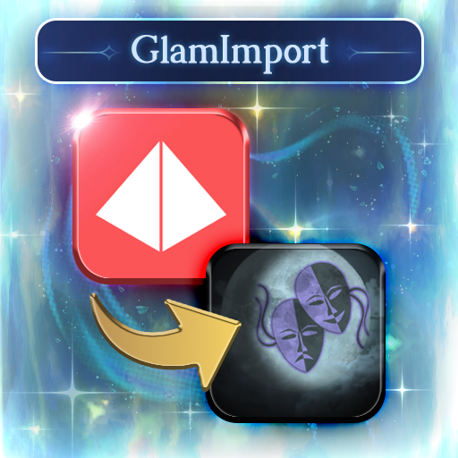

# GlamImport

A Dalamud plugin for FFXIV: copy a glam from a glamour site, paste it in, and GlamImport finds the gear and dyes and applies them to your character with Glamourer, or saves them as a Glamourer design.

**Requires:** [Glamourer](https://github.com/Ottermandias/Glamourer)
**Supported sites:** Eorzea Collection (ffxiv.eorzeacollection.com)

## Installation
1. Type `/xlsettings` in game and open the **Experimental** tab.
2. Under **Custom Plugin Repositories**, paste this URL, click **+**, and save:
   ```
   https://raw.githubusercontent.com/quilun/DalamudPlugins/main/repo.json
   ```
3. Open `/xlplugins`, search for **GlamImport**, and install it. [Glamourer](https://github.com/Ottermandias/Glamourer) needs to be installed too.

## How to use
1. Open a glam on Eorzea Collection in your browser.
2. Copy the page. Select all (Ctrl+A) to also get the glam's name, creator, tags and description, or select just the gear section.
3. In game, type `/glamimport` and paste the text, or click **Import from Clipboard**.
4. Check the list of gear and dyes, then:
   - **Apply to Yourself**, or **Apply to Target** for the character you're targeting (another player, an NPC, or a GPose actor).
   - **Save as Glamourer Preset** to keep it as a Glamourer design.
   - **Revert to Game** works like the button in Glamourer.

The clock button next to the settings button lists your last 10 applied or saved glams.

### Good to know
- If you copied the whole gear section, slots the glam leaves empty are taken off, including facewear. The weapon always stays, and pieces that couldn't be found are left as they are.
- A weapon your current job can't use is skipped when applying to yourself (hover "Other job" to see which jobs can use it). Saved presets still include it.
- Gear your character can't normally wear (gender- or race-locked) is applied according to your settings.
- Fashion accessories like parasols can't be applied by Glamourer and are listed as "Can't apply".

## Settings
Open with `/glamimport config`, the cog button in the window, or the plugin's settings button in `/xlplugins`.
- **Gender- or Race-Locked Gear:** let Glamourer decide (default), keep what you're wearing, or leave the slot empty. With "Let Glamourer decide", Glamourer's "Use Replacement Gear for Gear Unavailable to Your Race or Gender" setting chooses between a stand-in and a broken piece.
- **Glamourer Preset Tags:** saved presets get the glam's Eorzea Collection tags (Cute, Cosplay...) and an "Eorzea Collection" tag, so Glamourer's design search finds them with `t:Cosplay`.
- **Preset Descriptions:** the creator's description from Eorzea Collection, followed by an info block you can edit (glam name, creator, model, job, import date). Can be set to the creator's description only, or off.
- **Preset Names:** the default name for saved presets, `Eorzea Collection Import/{name} ({creator})`. Available tags: `{name}`, `{creator}`, `{job}`, `{gender}`, `{race}`, `{model}`, `{character}`, `{date}`, `{time}`, and `{DD}` `{MM}` `{YY}` `{YYYY}` `{HH}` `{mm}` for your own date format. A `/` creates a folder in Glamourer.

## License
GlamImport is licensed under the [GNU Affero General Public License v3.0](LICENSE).
